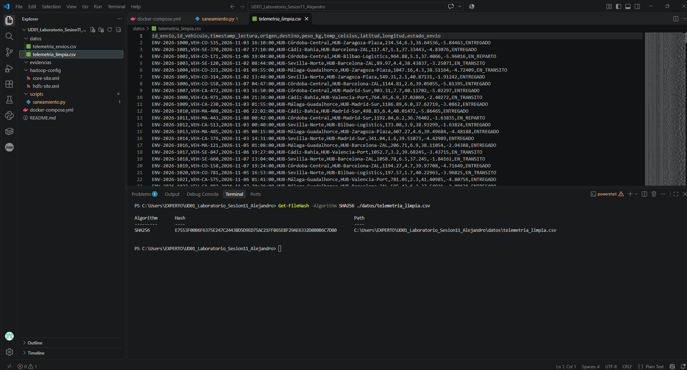
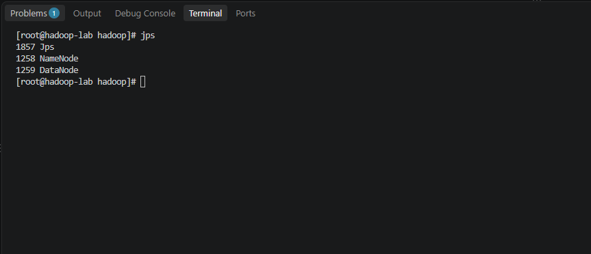
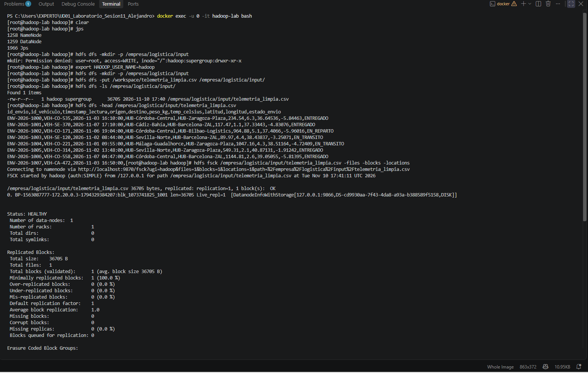
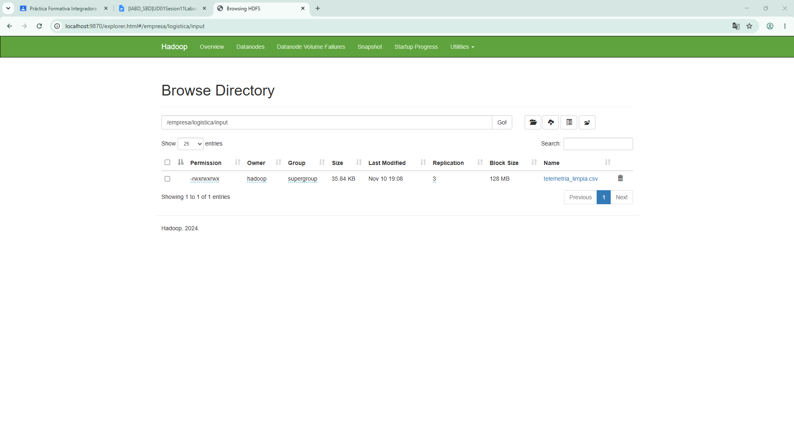

# Informe Técnico de la Práctica: Ecosistema HDFS y Calidad de Datos

> **Documentación de Proyecto:** Flujo de ingeniería de datos que abarca desde el saneamiento y validación criptográfica de datasets en bruto, hasta su ingesta y despliegue en un sistema de archivos distribuido (HDFS) mediante contenedores Docker.

---

## Estructura del Proyecto

A continuación se detalla la estructura exacta de directorios y archivos que componen este repositorio:

```text
UD01_Laboratorio_Sesion11_Alejandro/
├── README.md               # Informe técnico de la práctica (este documento)
├── docker-compose.yml      # Orquestación del contenedor Hadoop
├── datos/                  
│   ├── telemetria_envios.csv   # Dataset original en bruto
│   └── telemetria_limpia.csv   # Dataset saneado y depurado
├── evidencias/             
│   ├── 01_hashes_sha256.png
│   ├── 02_jps_servicios.png
│   ├── 03_hdfs_comandos_fsck.png
│   └── 04_webui_hdfs_browse.png
├── hadoop-config/          
│   ├── core-site.xml       # Configuración del núcleo de Hadoop
│   └── hdfs-site.xml       # Configuración del sistema de archivos distribuido
└── scripts/                
    └── saneamiento.py      # Script de limpieza
```

---

## Sección 1: Integridad (Módulo 5075)

Para garantizar la trazabilidad y certificar que la depuración de los datos no ha introducido alteraciones imprevistas, se ha aplicado la función hash criptográfica SHA-256 sobre los conjuntos de datos.

* **Dataset Original (`telemetria_envios.csv`):** Se calculó el checksum inicial antes de aplicar el script de limpieza para registrar la huella digital del estado puro de los datos brutos.
* **Dataset Saneado (`telemetria_limpia.csv`):** Tras ejecutar las reglas de calidad en el script de depuración (tratamiento de nulos, eliminación de anomalías y normalización), se extrajo el nuevo checksum. 

---

## Sección 2: Despliegue y HDFS (Módulo 5074)

El ecosistema de almacenamiento distribuido se ha desplegado mediante un contenedor Docker en modo *standalone* (Apache Hadoop). 

**1. Verificación del Contenedor y Puertos:**
Se validó la correcta exposición de los puertos clave en el *host*, mapeando específicamente el puerto `9870` para permitir el acceso a la NameNode Web UI desde el navegador local, mientras que la comunicación interna RPC se mantuvo aislada.

**2. Auditoría de Servicios:**
Dentro del contenedor, el arranque de los demonios de Hadoop se validó mediante el comando nativo de Java `jps`, confirmando la ejecución activa y sin errores de los procesos `NameNode` y `DataNode`.

**3. Comandos HDFS Ejecutados:**
La interacción con el clúster se realizó mediante la CLI de HDFS siguiendo esta operativa:
* `hdfs dfs -mkdir -p /empresa/logistica/input`: Creación de la estructura de directorios requerida.
* `hdfs dfs -put -f /workspace/telemetria_limpia.csv /empresa/logistica/input/`: Ingesta del fichero saneado en el sistema distribuido.
* `hdfs dfs -ls /empresa/logistica/input`: Listado y verificación del peso y los permisos del archivo volcado.
* `hdfs fsck /`:  Auditar los bloques físicos generados y que el ecosistema reporta un estado global `HEALTHY`.

---

## Sección 3: Análisis Crítico

**¿Por qué un fichero en HDFS no se corrompe ni se pierde aunque falle o se apague un DataNode en un clúster de producción?**

No se pierde ni se corrompe debido a su mecanismo de replicación de bloques y su arquitectura que es tolerante a fallos. Cuando subimos un archivo a HDFS este lo divide en fragmentos de hasta 128 MB o incluso 256MB, cada fragmento se replica 3 veces en diferentes DataNodes, esto permite que si un DataNodese apaga o falla, tenemos otras dos copias mas que siguen estando operativas en otros servidores del clúster.

Además, cuando el NameNode detecta que un DataNode ha dejado de responder, actualiza de forma automática el mapa del clúster e inicia un proceso de re-replicación en segundo plano. Esto significa que los bloques que albergaba el nodo caído se vuelven a duplicar en otros nodos sanos hasta restablecer el factor de replicación original, asegurando que la tolerancia a fallos se mantenga robusta de manera autónoma. También la orquestación central a cargo del NameNode monitoriza constantemente la salud del clúster mediante señales periódicas (heartbeats). 

Cuando se corrompen los datos también, HDFS previene este problema mediante verificaciones continuas de integridad usando sumas de verificación, a esto se le llama (checksums).
Si durante la lectura o las comprobaciones rutinarias se detecta que un bloque está corrupto, HDFS no utiliza esa copia dañada; en su lugar, descarta el bloque defectuoso y lo repara automáticamente clonando una réplica sana desde otro nodo del clúster.

---

## Sección 4: Evidencias Gráficas

A continuación, se documentan visualmente los hitos técnicos superados durante el despliegue y la operativa, alojados en el directorio `/evidencias`:

#### 1. Cálculo de firmas SHA-256


#### 2. Arranque de demonios Hadoop (jps)


#### 3. Comandos HDFS, Ingesta y Auditoría FSCK


#### 4. Verificación visual en WebHDFS
